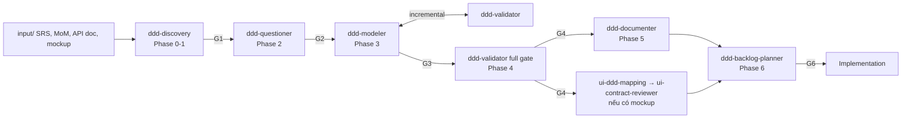

# DDD — Tài liệu → DDD artifacts → Backlog

Bộ skill chuyển tài liệu nghiệp vụ (SRS, BRD, meeting notes, RFP, API doc, DB schema, HTML mockup) thành bộ tài liệu **Domain-Driven Design** có kiểm định chất lượng: Domain Map, Glossary (Ubiquitous Language), Event Storm, Flow Diagrams, Read Models/Queries, Context Map, ADRs → Deliverables (BRD, Technical Overview, Onboarding) → Backlog có traceability.

Repo này là **bản gốc để chỉnh sửa**. Sửa ở đây, commit, rồi đồng bộ sang các dự án.

> [!WARNING]
> **Giới hạn: chưa hỗ trợ Code → DDD (reverse-engineering).** Pipeline chỉ ingest **tài liệu**. Phần liên quan đến code hiện có:
> - DB schema / API doc: dùng làm **nguồn đối chiếu (cross-reference)** trong `ddd-discovery` (Alias Verification, Meeting Notes Cross-Reference).
> - HTML mockup: `ui-ddd-mapping` gắn `data-screen-id` / `data-command` và phát hiện gap Screen ↔ Command/Query.
> - Code branch/commit: `ddd-backlog-planner` Step 6 chỉ dùng để **đối chiếu tiến độ** — không trích xuất domain model.
>
> Chưa có workflow đọc source code (entity, enum, state machine, controller, migration) để dựng domain model cho hệ thống brownfield. Mọi rule hiện tại coi code là **evidence**, không phải **authority** (xem `ui-contract-reviewer` § Source Priority).

## Pipeline



Gate G1-G6, Convergence Loop, layout thư mục chuẩn và template `project-state.md`: [_shared/references/gates-and-project-state.md](_shared/references/gates-and-project-state.md).

## Danh mục skill

| Skill | Ver | Phase | Vai trò |
|:--|:--|:--|:--|
| [ddd-discovery](ddd-discovery/SKILL.md) | 1.3 | 0-1 | Intake + 4-lens analysis; gates Extract/Infer, Enum Counting, Anti-Single-Write, Alias, BC Validation |
| [ddd-questioner](ddd-questioner/SKILL.md) | 1.2 | 2 | Câu hỏi 6 categories, P0/P1/P2, sub-question templates T1-T4, Late Discoveries |
| [ddd-modeler](ddd-modeler/SKILL.md) | 3.3 | 3 | Artifact pipeline theo dependency, BC Folder Completeness, Read Model & Query Modeling; `templates/` |
| [ddd-validator](ddd-validator/SKILL.md) | 3.5 | 3-4 | 49 rules (S, G, E, A, C, R + V/XB), severity, threshold ≥50%/category; `rules/` load on demand |
| [ddd-documenter](ddd-documenter/SKILL.md) | 2.1 | 5 | BRD, Technical Overview, Developer Onboarding |
| [ui-ddd-mapping](ui-ddd-mapping/SKILL.md) | 1.1 | UI gate | Hybrid SCEB: screen registry, UI Context, HTML annotation, gap detection; `references/` |
| [ui-contract-reviewer](ui-contract-reviewer/SKILL.md) | 1.0 | UI gate | Screen Contract Checklist field-level + UI AC; `references/` |
| [ddd-backlog-planner](ddd-backlog-planner/SKILL.md) | 1.2 | 6-7 | Stories (Write + Read), Gherkin, NFR AC, INVEST, Walking Skeleton, traceability, reconciliation |
| [mermaid-diagram](mermaid-diagram/SKILL.md) | 1.1 | all | Chuẩn diagram (dark theme, CMD/EVT/POL/PIV) |
| [doc-translate](doc-translate/SKILL.md) | 1.2 | all | Dịch EN→VI song ngữ, giữ thuật ngữ DDD |

`_shared/` (không phải skill): `AGENTS.template.md` (persona), `rules/` (pre-flight, validation protocol), `references/` (gates, layout, project-state).

## Cài đặt

Copy **toàn bộ** nội dung thư mục này (kể cả `_shared/`) vào thư mục skills — các skill tham chiếu `../_shared/...` bằng đường dẫn tương đối.

| Công cụ | Theo dự án | Toàn cục |
|:--|:--|:--|
| Antigravity / Gemini | `<project>/.agents/skills/` | `~/.gemini/config/skills/` |
| Claude Code | `<project>/.claude/skills/` | `~/.claude/skills/` |
| Codex | `<project>/.agents/skills/` | `~/.codex/skills/` |

```bash
# Ví dụ: cài vào một dự án
mkdir -p <project>/.agents/skills
rsync -a --exclude README.md ~/Documents/ChatGPT/My_Skills/DDD/ <project>/.agents/skills/
cp <project>/.agents/skills/_shared/AGENTS.template.md <project>/AGENTS.md   # rồi điền [ĐIỀN: ...]
```

Sau đó tạo `input/` và đặt tài liệu vào, tạo `project-state.md` theo template, rồi yêu cầu agent: *"Chạy Phase 0-1 discovery cho input/"*.

## Nguồn gốc

| Thành phần | Nguồn canonical |
|:--|:--|
| 7 skill ddd-* + mermaid + doc-translate + ui-* | `CRM_Phase2_full/cwc-team-source/crm-docs/.agents/skills` (bản mới nhất, 2026-08) |
| NFR Acceptance Criteria (backlog) | `Memo/.agents/skills/ddd-backlog-planner` v1.1 |
| Gates, Convergence Loop | `crm-docs/methodology/foundation/01-srs-to-ddd-methodology.md` Ch.4 |
| UI methodology reference | `crm-docs/methodology/evolution/04-ui-ux-domain-integration.md` |

Không đóng gói: `ddd-sim-engine` (vận hành dự án, phụ thuộc `SIMULATION.md`), `srs-requirement-baseliner` (hard-code SRS CRM).

Các ví dụ lỗi (SAP retry, ADAV/ADRR, Entity Key ≠ MVV, Prepaid Wallet, Memo skip flows) là **worked example thực chiến** từ CRM/Memo — giữ lại có chủ đích vì chính chúng là lý do tồn tại của từng rule.

## Changelog

| Date | Change |
|:--|:--|
| 2026-11-10 | Khởi tạo gói từ bản crm-docs. Sửa: validator workflow G1-G4→G1-G11, V9 dùng git time, taxonomy G2 ↔ template, G5/G6/G8/G9 bỏ hard-code CRM; backlog thêm NFR AC, pre-check UI có điều kiện, sửa ví dụ lẫn từ Memo; path generic `mapping/`, `input/mockups/`; bundle UI methodology; thêm `_shared` (gates G1-G6, convergence loop, layout, project-state template, persona generic, rules đồng bộ 49 rules); typo `ĐÚN`/`TRƯỜC`; bổ sung `version` còn thiếu; quote `description` của discovery/validator/ui-ddd-mapping (chứa `: ` làm YAML parser strict của Claude Code/Codex lỗi). |
