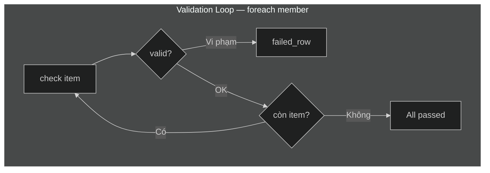

# Mermaid Diagram Standards — DDD Documentation

## Khi nào NÊN tạo Mermaid diagram

| Nội dung | Dùng Mermaid? | Loại diagram |
|:--|:--|:--|
| **Flow nghiệp vụ** (command → validation → event → policy) | ✅ NÊN | `flowchart TD` |
| **Integration / Context Map** (BC-to-BC relationships) | ✅ NÊN | `flowchart LR` |
| **Value Chain / Data Flow** (upstream → core → downstream) | ✅ NÊN | `flowchart LR` |
| **ER Diagram** (bảng DB + quan hệ FK) | ✅ NÊN | `erDiagram` |
| **Sequence / Tương tác API** | ✅ NÊN | `sequenceDiagram` |
| **State Machine** (PLANNED → ACTIVE → REMOVED) | ✅ NÊN | `stateDiagram-v2` |

## Khi nào KHÔNG dùng Mermaid

| Nội dung | Giữ nguyên format | Lý do |
|:--|:--|:--|
| **Event Storm overview** (big picture tree) | ASCII art | Sketch nhanh, layout 2D tự do, đúng tinh thần DDD "big picture on the wall" |
| **Bảng spec** (API endpoints, BR matrix, scoring) | Markdown table | Tables là format tối ưu cho dữ liệu dạng bảng |
| **ADR / Glossary** | Text | Văn bản quyết định / định nghĩa, không cần visualization |
| **Diagram đã có zoom-in flows riêng** | Giữ ASCII overview | Overview chỉ cần "bản đồ nhanh" để navigate xuống detail |

## Style Guide

### 1. Bắt buộc: Dark Theme Directive

Mọi mermaid block đều PHẢI bắt đầu bằng dark theme init:

````markdown

````

> **Lý do:** Team dùng dark theme IDE. Không có directive → node text bị invisible trên nền tối.

### 2. Layout Direction

| Use case | Direction | Lý do |
|:--|:--|:--|
| Business flow (command → event) | `flowchart TD` | Top-down = tuần tự theo thời gian |
| Integration / Value Chain | `flowchart LR` | Left-to-right = upstream → core → downstream |
| ER diagram | `erDiagram` | Auto layout |

### 3. Color Palette (Dark-mode friendly)

Tất cả node styles PHẢI có explicit `color:#fff` để đảm bảo text đọc được.

#### Context Map / Domain Map colors:

| Ý nghĩa | Fill | Stroke | Style code |
|:--|:--|:--|:--|
| **Core Domain** | `#2b8a3e` | `#69db7c` | `style X fill:#2b8a3e,stroke:#69db7c,color:#fff` |
| **Supporting Domain** | `#e67700` | `#ffd43b` | `style X fill:#e67700,stroke:#ffd43b,color:#fff` |
| **Generic Domain** | `#495057` | `#adb5bd` | `style X fill:#495057,stroke:#adb5bd,color:#fff` |
| **Upstream BC** | `#5f3dc4` | `#b197fc` | `style X fill:#5f3dc4,stroke:#b197fc,color:#fff` |
| **Downstream BC** | `#c92a2a` | `#ff8787` | `style X fill:#c92a2a,stroke:#ff8787,color:#fff` |
| **BC Container** | `#1e3a5f` | `#4dabf7` | `style X fill:#1e3a5f,stroke:#4dabf7,stroke-width:2px,color:#fff` |

#### Flow diagram colors:

| Ý nghĩa | Fill | Style code |
|:--|:--|:--|
| **Rejection / Error** | `#ff6b6b` | `style X fill:#ff6b6b,color:#fff` |
| **Success Event** | `#51cf66` | `style X fill:#51cf66,color:#fff` |
| **Warning / Validation** | `#ffd43b` | `style X fill:#ffd43b,color:#333` |
| **Subgraph (validation group)** | `#f8f9fa` | `style X fill:#f8f9fa,stroke:#868e96` |
| **Transaction block** | `#e7f5ff` | `style X fill:#e7f5ff,stroke:#339af0` |

#### Event Storm building blocks → Mermaid mapping:

> **Lưu ý:** Trong Event Storm workshop, mỗi block có màu sticky note riêng (🔵🟠🟣🟢🔴🟡⭐). Trong Mermaid **flow diagram**, ta dùng **UX convention** (đỏ = fail, xanh = success) cho outcome nodes, và phân biệt building block qua **shape + naming prefix**. Xem [srs_to_ddd_methodology.md §3.2](../../srs_to_ddd_methodology.md#32-event-storm--bản-đồ-hành-vi) để tra cứu bảng gốc.

| Block | Workshop 🎨 | Mermaid shape | Naming convention | Ghi chú |
|:--|:--|:--|:--|:--|
| **Command** 🔵 | Blue | `["CommandName"]` rectangle | `CMD["RemoveMember"]` | Đầu flow, sau Actor |
| **Event** 🟠 | Orange | `["EventName"]` rectangle | `EVT["MemberRemoved"]` | Style theo outcome: `#51cf66` success, `#ff6b6b` rejection |
| **Policy** 🟣 | Purple | `["P#: PolicyName"]` rectangle | `POL["P4: Soft Delete"]` | Trigger sau Event |
| **Read Model** 🟢 | Green | `[/"ReadModelName"/]` parallelogram | `RM[/"Employee Search"/]` | Data cần XEM trước Command |
| **Hot Spot** 🔴 | Red | `>"HS-##: Question"]` flag | `HS>"HS-01: Warning?"]` | Câu hỏi chưa chốt, dùng khi cần |
| **Aggregate** 🟡 | Yellow | `subgraph` với stroke vàng | `subgraph AGG ["SalesTeam"]` | Bọc nhóm nodes bảo vệ invariants |
| **Pivotal Event** ⭐ | Star | `["⭐ EventName"]` rectangle | `PIV["⭐ TeamCreated"]` | Viền dày: `stroke-width:3px` |

### 4. Node Naming Conventions

```
A["Actor: AMS/GL/BUL"]          -- Actor luôn ở đầu
CMD["RemoveMember"]              -- Command tiếp theo
RM[/"Employee Search"/]          -- Read Model = parallelogram (data cần xem trước)
C{Điều kiện kiểm tra?}          -- Decision = diamond {}
R1[Rejected<br/>REASON_CODE]     -- Rejection event = square [] + đỏ
EVT["MemberRemoved"]             -- Success event = square [] + xanh
POL["P4: Soft Delete"]           -- Policy trigger
HS>"HS-01: Warning mechanism?"]  -- Hot Spot = flag shape
PIV["⭐ TeamCreated"]            -- Pivotal Event = star emoji + viền dày
```

> **Aggregate** không dùng node riêng — dùng `subgraph AGG ["SalesTeam"]` để bọc nhóm nodes liên quan.

### 5. Subgraph cho Validation Loop

Khi có validation loop (bulk operations), bọc trong subgraph:



### 6. Edge Labels

- Dùng `-- "label" -->` cho labeled edges
- Giữ label ngắn (≤ 5 từ), dùng `<br/>` cho multi-line
- Luôn dùng double quotes cho labels chứa ký tự đặc biệt

## Checklist trước khi commit

- [ ] Mọi ```` ```mermaid ```` block có `%%{init: {'theme':'dark'}}%%`?
- [ ] Rejection nodes có `fill:#ff6b6b,color:#fff`?
- [ ] Success event nodes có `fill:#51cf66,color:#fff`?
- [ ] Node labels có explicit `color` nếu dùng custom `fill`?
- [ ] Layout direction phù hợp? (TD cho flow, LR cho integration)
- [ ] Preview trên dark theme đọc được? (`Cmd+Shift+V`)

## Existing Diagrams Reference

| File | Diagrams | Loại |
|:--|:--|:--|
| `docs/context-map.md` | 1 | `flowchart LR` — Integration Diagram |
| `docs/domain-map.md` | 1 | `flowchart LR` — Value Chain |
| `docs/architecture/data-model.md` | 1 | `erDiagram` — ER Diagram |
| `flows/team-management.md` | 4 | `flowchart TD` — Create, Update, ChangeUnit, Deactivate |
| `flows/member-assignment.md` | 3 | `flowchart TD` — Add, Remove, EditDates |
| `flows/lead-operations.md` | 2 | `flowchart TD` — ReplaceLead, Promote |
| `flows/member-transfer.md` | 2 | `flowchart TD` — MoveMember (PIV ⭐), Sequence |
| `flows/bulk-member-operations.md` | 2 | `flowchart TD` — BulkAdd, BulkMove |

> Tất cả flow diagrams sử dụng naming convention chuẩn: `CMD`, `EVT`, `POL`, `PIV` prefixes.

## IDE Setup

- **Extension:** `bierner.markdown-mermaid` (v1.32.1+)
- **Preview:** `Cmd+Shift+V` trên bất kỳ file `.md`
- **Không cần** MCP server hay export tool — preview trực tiếp trong IDE
