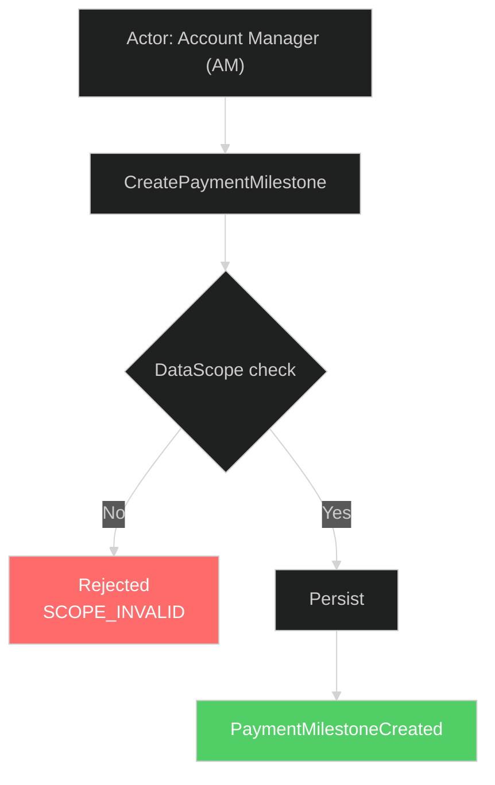

> **Ghi chú đóng gói (My_Skills/DDD):** Tài liệu methodology gốc từ dự án CRM, giữ nguyên làm worked example. Path `phase-2/mapping/` và `phase-2/input/mockups_*/` trong tài liệu này tương ứng với `mapping/` và `input/mockups/` trong layout generic (xem `../../_shared/references/gates-and-project-state.md` § Project Layout).

---
type: methodology
version: 3.0
contexts: [CRM Team Config, All Future BCs]
created: 2026-07-01
parent: 01-evolution-framework.md
purpose: Cách UI/UX và Domain tương tác 2 chiều — Hybrid SCEB Methodology
---

# 04 — UI/UX ↔ DDD Integration (Hybrid SCEB Methodology)

> SRS → DDD methodology bỏ qua UI. Nhưng khi phát triển tiếp, UI/UX và Domain **PHẢI tương tác 2 chiều**.
> Tài liệu này định nghĩa cách tương tác đó bằng phương pháp Hybrid SCEB (Screen-Command-Event Bridge).

---

## 1. Tại Sao Cần Methodology Này?

### 1.1 UI không chỉ là "vẽ screen"

Trong các dự án DDD, có một khoảng trống (gap) giữa 3 bên:

```
[UI/UX Mockups]  ←— ???  —→  [DDD Artifacts]  ←— ???  —→  [Development Backlog]
```

- **UI team** giao mockup HTML/Figma — nhưng không biết Command nào xử lý form submit
- **DDD team** viết aggregates, events, policies — nhưng không biết user thấy gì trên màn hình
- **Dev team** nhận cả hai — phải tự ghép nối, dễ thiếu sót invariants

```
WRONG: UI Designer vẽ → Dev build theo → Done
RIGHT: UI Designer vẽ → Phát hiện domain gap → Domain update → UI finalize → Dev build
```

### 1.2 Triết lý "Design-Domain Contract"

```
UI/UX spec = Consumer Contract
Domain artifacts = Provider Contract

UI spec nói: "Tôi cần DATA gì + ACTION gì"
Domain spec nói: "Tôi CUNG CẤP data gì + CHẤP NHẬN commands gì"

Contract = giao kèo giữa 2 bên:
  - UI không tự bịa data fields
  - Domain không tự thêm commands mà không ai dùng
  - Mismatch = gap → phải resolve
```

### 1.3 Giải pháp: Hybrid SCEB

Thay vì tạo **mapping matrix riêng biệt** (nhanh outdated), SCEB **gắn thông tin UI trực tiếp vào DDD artifacts**:

```
[Mockup] — SCR-B02 —→ [Flow Diagram: UI Context section] —→ [Aggregate: UI Mapping table]
                            │
                            ↓
                    [Backlog: User Story + AC]
```

**Nguyên tắc cốt lõi**: Data sống bên trong DDD artifacts, không tạo matrix riêng biệt.

---

## 2. Nền Tảng Lý Thuyết

### 2.1 Design-Level Event Storming (Brandolini, 2021)

Sau Big Picture Event Storm (phase discovery), zoom vào từng aggregate. Ở Design Level, Brandolini mở rộng notation:

```
┌──────────┐    ┌──────────┐    ┌──────────┐    ┌──────────┐
│ 🟨 Read  │ →  │ 👤 Actor │ →  │ 🟦 Command│ →  │ 🟧 Event │
│   Model  │    │ + Screen │    │          │    │          │
│ (UI View)│    │          │    │          │    │          │
└──────────┘    └──────────┘    └──────────┘    └──────────┘
     ↑                                               │
     └───────────────── 🟪 Policy ──────────────────┘
```

**SCEB áp dụng**: Mỗi Command trong aggregate → gắn `Screen ID` reference. Mỗi Read Model → gắn `UI Fields` reference. Mermaid flowcharts visualize toàn bộ flow.

### 2.2 Screen ID System

Mỗi screen trong mockup nhận một **ID cố định** (không đổi khi UI redesign):

| Prefix | BC / Area | Ví dụ |
|:-------|:----------|:------|
| `SCR-B` | BC-1 Payment | SCR-B01, SCR-B02... |
| `SCR-I` | BC-2 Invoicing | SCR-I01, SCR-I02... |
| `SCR-D` | D2 Access Control | SCR-D01, SCR-D02... |
| `SCR-X` | Shared / Config | SCR-X01, SCR-X02... |

Screen IDs là **traceability key** xuyên suốt: `Screen Registry → Flow Diagrams → Aggregates → Glossary → Backlog`.

### 2.3 Design-Domain Contract — Mô hình 2 chiều

#### Top-Down: UI → Domain (UI phát hiện domain needs)

```
UI Wireframe / Mockup
  ↓ Extract
UI Data Requirements
  ├── Data fields hiển thị (Read Model)
  ├── Actions user có thể thực hiện (Commands)
  ├── Validation rules visible (Preconditions)
  └── Status/states hiển thị (State Machine)
  ↓ Map
Domain Artifacts
  ├── Glossary (terms/attributes used)
  ├── Event Storm Read Models (data queries)
  ├── Event Storm Commands (user actions)
  └── Glossary Lifecycle (state machines)
  ↓ Check
Gap Analysis
  ├── Data field trên UI nhưng không có trong Glossary? → GAP
  ├── Action trên UI nhưng không có Command trong ES? → GAP
  ├── Validation trên UI nhưng không có BR? → GAP
  └── No gaps → ✅ Contract aligned
```

#### Bottom-Up: Domain → UI (Domain thay đổi → UI phải review)

```
Domain Change (CR processed)
  ↓ Impact on UI?
  ├── New Command → UI cần form/button mới?
  ├── New Event → UI cần notification/refresh?
  ├── New Read Model → UI cần screen/section mới?
  ├── Invariant sửa → UI validation message thay đổi?
  ├── State Machine sửa → UI state display thay đổi?
  └── No UI impact → ✅ Done
  ↓
UI Design Update needed
  → Update UI spec → Re-verify contract → Implement
```

### 2.4 UI Component → Domain Primitive Mapping

#### Standard Mapping Patterns

| UI Component | Domain Primitive | Ví dụ |
|:--|:--|:--|
| Form + Submit button | Command | Add Member form → `AddMember` command |
| Data table | Read Model | Team list table → `RM-TeamList` |
| Status badge | Value Object (enum) | "ACTIVE" badge → `TeamStatus.ACTIVE` |
| Filter dropdown | Value Object attribute | Unit filter → `Unit` value object |
| Validation error | Precondition/Invariant violation | "Already in team" → BR-12 violation |
| Toast notification | Domain Event reaction | "Member added successfully" → `MemberAdded` event |
| Confirmation dialog | Command with side effects | "Remove member?" → `RemoveMember` pre-check |
| Loading spinner | Async command processing | Bulk import → `ImportMembers` async |
| Progress bar | Saga/Process Manager state | Import progress → `ImportBatch.progress` |
| Audit trail table | Event log (read model) | History tab → `RM-AuditLog` |

#### Khi nào UI CẦN domain support mới

| UI Pattern | Khi nào cần new domain artifact |
|:--|:--|
| **Real-time update** | Cần Domain Event + subscription mechanism |
| **Undo/Redo** | Cần Compensating Command (new command) |
| **Drag-and-drop reorder** | Cần `UpdateOrder` command + `order` attribute |
| **Inline edit** | Cần granular Update command (vs. full-object Update) |
| **Wizard (multi-step form)** | Cần Process Manager / Saga |
| **Optimistic UI** | Cần Event + Rollback mechanism |
| **Offline support** | Cần Command queue + Conflict resolution strategy |

### 2.5 Read Model Design — Bridge giữa UI và Domain

```
Command side: "Hệ thống LÀM gì khi nhận lệnh"
Query side:   "Hệ thống HIỆN gì cho user"

Read Model = Query side specification.
Nó trả lời: "User cần xem DATA GÌ trước khi ra quyết định?"
```

Mỗi BC nên có 1 file catalog. Ví dụ:

```markdown
## RM-01: Team List View
- **Used by screen:** Team Management → List
- **Data:** team_id, name, status, unit, lead_name, member_count, created_at
- **Filters:** status, unit, search by name
- **Sort:** name ASC (default), created_at DESC
- **Pagination:** 20 per page
- **Source aggregates:** SalesTeam + TeamMember (joined)
- **Freshness:** Real-time (no cache)

## RM-02: Team Detail View
- **Used by screen:** Team Management → Detail
- **Data:** All RM-01 fields + members list (name, ldap, role, status, join_date)
- **Source aggregates:** SalesTeam + TeamMember + Employee (cross-BC lookup)
- **Cross-BC:** Employee name from Identity & Access BC via ACL
```

Trong Event Storm, mỗi Command đã có cột `Read Model`:

```
| Command | Read Model | Meaning |
| AddMember | RM-TeamDetail + RM-EmployeeSearch | User cần xem team detail + search employee trước khi add |
```

**UI Screen Spec references Read Model → Read Model links to Event Storm Command.**
Đây là "traceability chain" từ UI → Domain.

---

## 3. Cấu Trúc Artifacts (6 Layers)

SCEB tạo ra 6 layers, mỗi layer bổ sung cho layer trước:

```
Layer 1: Screen Registry          ← Catalog tất cả screens
Layer 2: Aggregate UI Mapping     ← Gắn Command ↔ Screen
Layer 3: Flow Diagrams + UI Context ← Chi tiết hành vi + Mermaid visualization
Layer 4: HTML Annotation          ← Gắn data-command, data-screen-id vào mockup HTML
Layer 5: Gap Detection            ← Phát hiện thiếu sót
Layer 6: Change Tracking          ← Theo dõi thay đổi mockup
```

### 3.1 Screen Registry (`phase-2/mapping/screen-registry.md`)

Một file duy nhất catalog tất cả screens. Mỗi screen có:

```markdown
| ID | Screen Name | File | Type | Actor | Version | Notes |
|:---|:------------|:-----|:-----|:------|:--------|:------|
| SCR-B01 | Payment List | payment_list.html | List | AM, Sale SP | v2 (auto) | ... |
```

### 3.2 Aggregate UI Mapping Section

Trong mỗi aggregate file (ví dụ `aggregate-payment-milestone.md`), thêm section cuối:

```markdown
## UI Mapping

| Command | Screen | Trigger UI Element | Notes |
|:--------|:-------|:-------------------|:------|
| CreatePaymentMilestone | SCR-B02 | Submit form | Full create form |

| Read Model | Screen | Fields Displayed |
|:-----------|:-------|:-----------------|
| PaymentListItem | SCR-B01 | key, projectCode, contract, title, ... |
```

### 3.3 Flow Diagram + UI Context

Mỗi flow diagram (ví dụ `flows/create-payment-milestone.md`) có **3 phần**:

#### Phần 1: UI Context Table (Brandolini Design-Level)

```markdown
## UI Context (Brandolini Design-Level)

| Attribute | Value |
|:----------|:------|
| Screen | **SCR-B02** ([Create_payment_milestone.html](...link...)) |
| Entry Point | SCR-B01 (Payment Milestone List) → Click "Create Payment" button |
| Actor | Account Manager (AM) |
| Form Fields | Contract (select), Duration (date range), Title (text) |
| Success Action | Redirect → SCR-B01 + Toast "Created successfully" |
| Error Action | Inline validation messages per field |
```

#### Phần 2: Mermaid Flowchart (Command → Validation → Event → Policy)



#### Phần 3: Color Legend

| Màu | Ý nghĩa |
|:--|:--|
| 🔴 Đỏ `#ff6b6b` | Rejection — command bị từ chối |
| 🟢 Xanh lá `#51cf66` | Success event |
| 🟡 Vàng `#ffd43b` | Policy trigger — hành động tự động |
| 🔵 Xanh dương `#4dabf7` | Branching logic |
| ⭐ Viền dày | Pivotal event — chuyển phase trạng thái aggregate |

### 3.4 HTML Annotation (Mockup ↔ DDD Bridge)

Gắn `data-*` attributes trực tiếp vào HTML mockup để tạo **traceability bridge**.

> **Nền tảng**: Living Documentation (Cyrille Martraire, 2019) — artifacts tự mô tả, không cần docs trung gian.

| Attribute | Gắn vào | Giá trị | Mục đích |
|:----------|:--------|:--------|:---------|
| `data-screen-id` | Root `<div>` của page | `SCR-B05` | Identify screen — 1 per page |
| `data-command` | `<button>`, `<form>` submit | `AddPaymentItem` | Map trigger → DDD command |
| `data-navigate` | `<a>`, `<button>` navigation | `SCR-B04` | Map navigation → target screen |

#### Ví dụ

```html
<!-- Root container -->
<div data-screen-id="SCR-B05">

  <!-- Form submit → DDD Command -->
  <button data-testid="btn-save-payment-item" 
          data-command="AddPaymentItem">
    Save
  </button>

  <!-- Navigation → Target screen -->
  <a data-testid="link-back-to-detail"
     data-navigate="SCR-B04">
    ← Back to Detail
  </a>

</div>
```

#### Ranh giới — KHÔNG annotate

- ❌ `data-event` — Events thuộc về aggregate/flow docs
- ❌ `data-policy` — Policies thuộc về aggregate/flow docs
- ❌ `data-aggregate` — Quá chi tiết, gây coupling
- ❌ `data-validation` — Validation rules thuộc về flow docs

**Lý do giới hạn**: Mockup là *UI specification*, không phải *DDD specification*. Chỉ bridge **trigger** (user click gì) → **command** (hệ thống xử lý gì). Chi tiết business logic sống trong DDD artifacts.

### 3.5 Late Discoveries (`phase-2/mapping/late-discoveries.md`)

Gaps phát hiện trong quá trình mapping — append-only log:

```markdown
## [LATE-P0] LD-01: Missing EditPaymentMilestone Command

| Attribute | Value |
|:----------|:------|
| Discovered during | UI Mapping — aggregate × SCR-B03 |
| Impact | Developer tự implement mà không có invariants |
| Action needed | ❓ Clarify với BA/PO |
```

### 3.6 Change Tracking (`phase-2/mapping/mockup-changelog.md`)

Chỉ cập nhật khi nhận mockup mới:

| Change Type | DDD Impact |
|:------------|:-----------|
| `COSMETIC` | ✅ None — CSS only |
| `FIELD_ADDED/REMOVED` | ⚠️ Check glossary + aggregate |
| `ACTION_ADDED/REMOVED` | ⚠️ Check command + flow |
| `SCREEN_ADDED/REMOVED` | ⚠️ Full mapping needed |
| `FLOW_CHANGED` | ⚠️ Check flow diagram |

---

## 4. Quy Trình Thực Hiện — 5 Bước

### Bước 1: Screen Inventory (~1h — chạy trước Modeling)
1. Quét toàn bộ mockup folder
2. Gán Screen ID (SCR-Bxx, SCR-Ixx, SCR-Dxx, SCR-Xxx)
3. Phân loại: Type, Actor, Version
4. Output: `phase-2/mapping/screen-registry.md`

### Bước 2: Enrich DDD Artifacts (~1h/aggregate — gắn vào Modeling Rounds)
1. **Aggregate**: Thêm `## UI Mapping` section
2. **Flow Diagrams**: Thêm `## UI Context (Brandolini Design-Level)` table + Mermaid flowchart
3. **Glossary**: Thêm `## UI Presence` line (chỉ rõ screens nào hiển thị term)

### Bước 2b: Annotate HTML Mockups (~15min/screen)
1. Thêm `data-screen-id` vào root container
2. Thêm `data-command` vào trigger buttons/forms
3. Thêm `data-navigate` vào navigation links

### Bước 3: Gap Detection (~30min — sau Modeling)
- **Gap A**: Command không có Screen → Missing UI hoặc API-only?
- **Gap B**: Screen không có Command → Missing business logic?
- **Output**: `late-discoveries.md` (append-only log)

### Bước 4: Review & Cleanup
1. Verify tất cả Screen IDs nhất quán giữa registry, flows, aggregates
2. Verify relative paths và clickable links

### Bước 5: Change Tracking (Ongoing)
Khi nhận mockup mới từ UI/UX team → update `mockup-changelog.md` → trace DDD impact.

---

## 5. Tích Hợp Với DDD Modeling Plan

```
Bước 1 (Screen Registry)     ←── Chạy TRƯỚC Round 1
  │
Round 1 (Foundation)          ←── Không thay đổi
  │
Round 2 (BC-1 Payment)        ←── Bước 2 gắn vào: aggregate, flows, glossary
  │
Round 3 (BC-2 Invoicing)      ←── Bước 2 gắn vào: aggregate, flows
  │
Round 4 (Cross-BC)            ←── Không thay đổi
  │
Post-Modeling                  ←── Bước 3, 4, 5
```

### Effort Estimate

| Bước | Effort | Ghi chú |
|:-----|:-------|:--------|
| Bước 1 (Registry) | ~1h | Chạy 1 lần trước modeling |
| Bước 2 (Enrichment) | ~30min/aggregate × 2 = 1h | +15% effort Rounds 2-3 |
| Bước 3 (Gap Detection) | ~30min | 1 lần sau modeling |
| Bước 4 (Cleanup) | ~1h | Viết tắt + Mermaid quotes |
| Bước 5 (Tracking) | ~15min/update | Chỉ khi có mockup mới |
| **Tổng thêm** | **~4h** | **~+10% so với modeling plan gốc** |

---

## 6. Anti-patterns

Trong quá trình thực hiện 5 bước trên, cần tránh các anti-patterns phổ biến:

| ❌ Anti-pattern | ✅ Correct approach | Tại sao |
|:--|:--|:--|
| Designer tự đặt tên field | Field name khớp Glossary term | Naming inconsistency = confusion |
| Dev tự quyết validation message | Message text from BR description | Message ≠ domain rule = user confused |
| UI show data mà domain không cung cấp | Mọi UI data phải có domain source | Phantom data = bug waiting to happen |
| UI skip domain events | Mọi domain event → review UI impact | Missed refresh = stale UI |
| Domain thêm command mà không tell UI team | Command → review UI → form needed? | Orphan command = unused feature |

---

## 7. Tích Hợp AI

### 7.1 AI Capabilities

| Task | AI Role | Human Role |
|:--|:--|:--|
| Extract data fields from wireframe | AI reads Figma/image → list fields | Verify completeness |
| Map fields to Glossary | AI scan Glossary → suggest matches | Confirm/override |
| Identify unmapped fields | AI diff UI fields vs domain | Decide: domain gap or UI-only |
| Generate Screen Spec draft | AI fill template | Review + refine |
| Detect state machine inconsistency | AI compare UI states vs Glossary lifecycle | Validate business logic |
| Generate Read Model from wireframe | AI extract data needs → RM catalog entry | Review data sources |

### 7.2 AI Prompt: Wireframe → Screen Spec

```
Đây là wireframe cho screen [tên screen]:
[paste image hoặc text description]

Dựa trên DDD artifacts hiện có:
- Glossary terms: [list]
- Event Storm commands: [list]
- Read Models: [list]

Tasks:
1. Liệt kê mọi data field trong wireframe
2. Map mỗi field đến Glossary term (hoặc đánh dấu GAP)
3. Liệt kê mọi user action → map đến Command (hoặc GAP)
4. Liệt kê validation rules → map đến BR (hoặc GAP)
5. Tạo Screen Spec theo template chuẩn
6. Highlight domain gaps cần resolve

Output: Screen Spec markdown.
```

---

## 8. Lợi Ích

### Cho Backlog Generation

SCEB chuẩn bị **UI context nhúng sẵn** trong DDD artifacts. Skill `ddd-backlog-planner` kế thừa toàn bộ context đó khi chạy Phase 6:

```
[ui-ddd-mapping chạy TRƯỚC]          [ddd-backlog-planner chạy SAU]
SCEB enriches flows/*.md        →     Backlog Planner đọc flows/*.md
  ├── UI Context table                  ├── Step 1: Command → Story (+ Screen field)
  ├── Entry Point                       ├── Step 2: Gherkin Given từ Entry Point
  ├── Form Fields                       │           Gherkin When từ Submit button
  ├── Success/Error Action              │           Gherkin Then từ Success/Error
  └── Late Discoveries (LD-xx)          └── Step 1: LD-xx → Spike Story (SP-BC-xxx)
```

#### Mapping: UI Component → Backlog Item

| UI Component (từ SCEB) | → | Backlog Item trong `ddd-backlog-planner` |
|:--|:--|:--|
| Screen (`SCR-Bxx`) | → | Field `**Screen:**` trong story |
| Entry Point (`SCR-B01 → Click "X"`) | → | `Given` trong Gherkin (user đang ở đâu) |
| Form Fields (Contract, Duration) | → | Subtask build form + `Given` data user điền |
| Submit button (`data-command="Cmd"`) | → | `When` trong Gherkin (command trigger) |
| Success Action (redirect + toast) | → | `Then` happy path trong Gherkin |
| Error Action (inline validation) | → | `Then` error path trong Gherkin |
| Pre-load Data (Read Model) | → | `Given` precondition — data đã load trước |
| Conditional UI (show/hide fields) | → | Separate story hoặc subtask với rule BR-xx |
| Loading spinner (async command) | → | Technical Subtask + AC Note về async behavior |
| Wizard (multi-step form) | → | Process Manager Spike (SP-BC-xxx) trước khi story |
| Late Discovery (`LD-xx`) | → | Spike Story `SP-BC-xxx` trong backlog |

#### Ví dụ: UI Context → Story đầy đủ

Flow file sau khi SCEB enriched:
```markdown
## UI Context (Brandolini Design-Level)
| Screen       | SCR-B02 (Create_payment_milestone.html) |
| Entry Point  | SCR-B01 → Click "Create Payment" |
| Actor        | Account Manager (AM) |
| Form Fields  | Contract (select), Duration (date range), Title (text) |
| Success      | Redirect → SCR-B01 + Toast "Created successfully" |
| Error        | Inline validation messages per field |
```

→ `ddd-backlog-planner` sinh ra story:
```markdown
### US-BL-002: Tạo Payment Milestone
**As a** Account Manager (AM), **I want** to create a payment milestone,
**so that** the payment schedule is formally tracked.
**Source:** CreatePaymentMilestone | flows/create-payment-milestone.md | BR-07
**Screen:** SCR-B02 (Create_payment_milestone.html)
**Entry Point:** SCR-B01 → "Create Payment" button

#### Subtasks
- [ ] TT-BL-002a: Build SCR-B02 form (Contract, Duration, Title)
- [ ] TT-BL-002b: Redirect SCR-B01 on success + Toast
- [ ] TT-BL-002c: Inline validation messages per field

#### Example Mapping
```gherkin
Scenario: Tạo milestone thành công
  Given Account Manager đang xem SCR-B01 (Payment List)
  And contract #C001 ở trạng thái ACTIVE
  When AM click "Create Payment" → SCR-B02, điền form, click Save
  Then PaymentMilestoneCreated event raised
  And redirect về SCR-B01 + Toast "Created successfully"

Scenario: Contract INACTIVE bị reject
  Given contract #C002 ở trạng thái INACTIVE
  When AM submit form trên SCR-B02
  Then inline error tại field Contract: CONTRACT_NOT_ACTIVE
```
```

#### Thứ tự chạy Skills (bắt buộc)

```
Phase 3: ddd-modeler
    ↓
ui-ddd-mapping  ← PHẢI chạy trước backlog planning
    ├── Screen Registry
    ├── Enrich flows/*.md (UI Context tables)
    ├── Enrich aggregate-*.md (UI Mapping)
    ├── HTML annotations (data-command, data-screen-id)
    └── Gap Detection → late-discoveries.md
    ↓
Phase 4: ddd-validator
    ↓
Phase 6: ddd-backlog-planner  ← kế thừa toàn bộ UI context
```

> [!NOTE]
> Nếu `ui-ddd-mapping` **chưa chạy**, `ddd-backlog-planner` vẫn hoạt động nhưng story sẽ thiếu Screen field, Gherkin sẽ thiếu UI preconditions, và Late Discoveries sẽ không được tracking thành Spike stories.

### Cho Development Team
- Developer đọc **1 flow file** → hiểu cả business logic lẫn UI behavior
- Mermaid diagrams = visual spec, không cần đọc dài dòng
- Story template kèm Screen ID → biết ngay file mockup nào để tham chiếu
- Late Discoveries = explicit TODO list, không bị miss

### Cho UI/UX Change Tracking
- Mockup mới → `mockup-changelog.md` → Change Type → DDD Impact analysis
- Change Type `ACTION_ADDED` → cần Command mới → cần story mới trong backlog
- Change Type `SCREEN_ADDED` → full mapping needed → story mới + subtasks

---

## 9. Thống Kê Triển Khai Thực Tế (CRM Phase 2)

| Metric | Giá trị |
|:-------|:--------|
| Tổng screens | 29 (10 Payment + 11 Invoicing + 3 D2 + 2 Config + 3 Shared) |
| Flows enriched | 17 (7 Payment + 10 Invoicing) |
| Diamond nodes quoted | 43 |
| Viết tắt expanded | 9 loại (AM, KT, KTT, KTV, PM, DP, AV, GL, DU) |
| Late Discoveries | 3 (LD-01 to LD-03) |
| HTML annotations | Planned (Bước 2b) |

---

## Phụ Lục: File Map

```
phase-2/mapping/
├── screen-registry.md        ← Layer 1: Screen catalog
├── late-discoveries.md       ← Layer 5: Gap log
└── mockup-changelog.md       ← Layer 6: Change tracking

docs/bounded-contexts/{bc}/
├── aggregate-*.md            ← Layer 2: UI Mapping section
└── flows/*.md                ← Layer 3: UI Context + Mermaid
```
