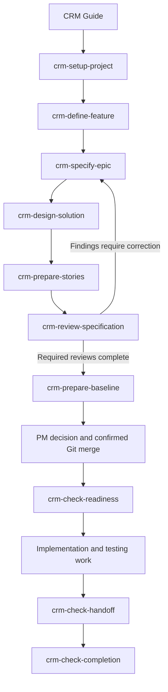

# Start Here

ID: **CRM-START** · CRM Workflow Kit 1.5.0 · 03/11/2026

## Install or Check an Installation

Đọc [INSTALL.md](INSTALL.md): helper tạo một package tự chứa cho Antigravity/Claude, config repo riêng, scaffold và scoped instructions khi chưa có. Bắt đầu bằng install dry-run → --apply → doctor → fresh-session smoke test. Teammate nhận repo đã commit: doctor và xác nhận discovery, không cần sửa lại binding trong skill.

Có thể yêu cầu agent: “Đọc INSTALL.md trong kit và chuẩn bị cài vào repo này; cho tôi xem dry-run và các file sẽ tạo.” Lệnh quản trị không tự là slash command ở mọi nền tảng. Source kit dùng tên crm-specification-standard; installed skill dùng crm-spec-kit.

## Dùng kit lần đầu

Kit này giúp quản lý requirement/backlog và các điểm bàn giao CRM. Mở folder bằng agent có quyền đọc tài liệu, yêu cầu đọc [SKILL.md](SKILL.md), rồi nêu việc muốn làm. Nếu runtime đã được cài skill riêng thì có thể gọi theo cú pháp runtime đó; bản repo này không tự cài hoặc đăng ký slash commands.

> Dùng crm-specification-standard. Tôi là BA, đang có yêu cầu sơ bộ dưới đây. Hãy xác định bước hiện tại, chức năng phù hợp và đầu vào còn thiếu.

Nếu biết chức năng, nêu ID cùng target/scope/refs:

> Dùng crm-check-readiness trong crm-specification-standard để kiểm Story STORY-CRM-001 theo baseline được cung cấp. Chỉ ra evidence đã có, phần thiếu và người cần xác nhận.

CRM Guide xác định context, nói ngắn function/profile/output dự kiến, rồi đọc đúng workflow. Nếu nhiều target hợp lý thì hỏi trước khi sửa. Không cần nhớ Q/D hoặc đường dẫn model; workflow và mapping dẫn tới các phần cần đọc.

## Chọn theo giai đoạn

| Bạn đang cần | Bắt đầu | Người nhận đầu ra |
|---|---|---|
| Thiết lập quy ước/policy dự án | [crm-setup-project](workflows/crm-setup-project.md) | PM + authority từng policy |
| Làm rõ nhu cầu/phạm vi năng lực | [crm-define-feature](workflows/crm-define-feature.md) | Business/BA/PM |
| Làm rõ hành vi và rule Epic | [crm-specify-epic](workflows/crm-specify-epic.md) | Business + Dev/TL + QA |
| Phân tích solution/contracts/feasibility | [crm-design-solution](workflows/crm-design-solution.md) | TL + QA, Business khi đổi nghĩa |
| Phân rã/làm rõ Story, kế hoạch/Task tùy chọn | [crm-prepare-stories](workflows/crm-prepare-stories.md) | Reviewer chuyên môn + PM |
| Phản biện spec/models | [crm-review-specification](workflows/crm-review-specification.md) | Tác giả sửa findings; authority xác nhận |
| Chuẩn bị baseline để PM review | [crm-prepare-baseline](workflows/crm-prepare-baseline.md) | PM; người có quyền merge/tạo ticket ở bước thực thi riêng |
| Kiểm đủ điều kiện nhận việc | [crm-check-readiness](workflows/crm-check-readiness.md) | Dev/QA + PM planning |
| Kiểm bộ bàn giao Dev→QA | [crm-check-handoff](workflows/crm-check-handoff.md) | Dev + QA |
| Kiểm AC/DoD/acceptance để hoàn tất | [crm-check-completion](workflows/crm-check-completion.md) | Reviewer/QA/PM/Business theo target |
| Đánh giá thay đổi sau baseline | [crm-assess-change](workflows/crm-assess-change.md) | Authority + PM + authors |
| Báo cáo tiến độ/blocker | [crm-report-status](workflows/crm-report-status.md) | PM + owners |
| Thử quy trình và ghi evidence sử dụng | [crm-run-pilot](workflows/crm-run-pilot.md) | Pilot participants + PM |

## Chọn theo vai trò con người

PM thường dùng setup-project, prepare-baseline, report-status, assess-change và run-pilot. BA dùng define-feature, specify-epic và prepare-stories. Dev/TL dùng design-solution và check-readiness; QA dùng review-specification, check-readiness, check-handoff và check-completion. Business tham gia làm rõ và quyết định outcome/rule/acceptance. Đây là gợi ý điểm vào, không khóa function theo chức danh; authority thật vẫn theo policy.

## Luồng bàn giao

Luồng là định hướng, không bắt chạy lại từ đầu. Có Epic hiện hành thì vào đúng bước; Story có baseline thì có thể kiểm DoR ngay. Stories trước baseline là candidates; Jira Stories thực thi theo manifest chỉ được tạo sau gate baseline. Task tùy nhu cầu, không bắt mỗi Story có ticket Task. Implementation/testing thực tế do công việc/công cụ được cấp quyền bên ngoài workflow kit này thực hiện.

## Function Menu

| Function | Output và workflow | AI profile |
|---|---|---|
| `crm-setup-project` — Set Up Project | [Draft policy register/context, artifact-location map và missing-decision queue; approval để riêng.](workflows/crm-setup-project.md) | Delivery Coordinator |
| `crm-define-feature` — Define Feature | [Feature F01–F08, source/outcome/scope, acceptance method, Epic candidates và decisions cần authority.](workflows/crm-define-feature.md) | Requirements Analyst |
| `crm-specify-epic` — Specify Epic | [Epic spec/model inventory, BR/AC refs, question log, applicability và solution/decomposition inputs.](workflows/crm-specify-epic.md) | Requirements Analyst |
| `crm-design-solution` — Design Solution | [Solution/contract draft, rationale, dependency/feasibility record, verification approach và open technical decisions.](workflows/crm-design-solution.md) | Solution Architect |
| `crm-prepare-stories` — Prepare Stories | [Story drafts/manifest, allocation/INVEST record, execution checklist hoặc optional Task briefs trong phạm vi được giao.](workflows/crm-prepare-stories.md) | Requirements Analyst |
| `crm-review-specification` — Review Specification | [Review record, inventory/evidence refs, findings với witness, verdict scoped và correction/handoff actions.](workflows/crm-review-specification.md) | Quality Reviewer |
| `crm-prepare-baseline` — Prepare Baseline | [PM review package/gap list và evidence index; baseline receipt chỉ khi commit/merge đã được xác nhận.](workflows/crm-prepare-baseline.md) | Delivery Coordinator |
| `crm-check-readiness` — Check Readiness | [DoR check record, evidence/gap list, gate impact và next actions; không thay target hoặc Jira state.](workflows/crm-check-readiness.md) | Quality Reviewer |
| `crm-check-handoff` — Check Handoff | [Handoff check record scoped theo baseline/build, missing/stale evidence và next actions cho Dev/QA.](workflows/crm-check-handoff.md) | Quality Reviewer |
| `crm-check-completion` — Check Completion | [Completion check record và evidence index, findings, missing authority và điều kiện còn thiếu để chốt.](workflows/crm-check-completion.md) | Quality Reviewer |
| `crm-assess-change` — Assess Change | [Impact assessment, affected artifact/evidence list, missing decisions và correction/revalidation plan.](workflows/crm-assess-change.md) | Delivery Coordinator |
| `crm-report-status` — Report Status | [Progress report tách readiness, delivery, acceptance và blocker, có snapshot/mẫu số/source refs.](workflows/crm-report-status.md) | Delivery Coordinator |
| `crm-run-pilot` — Run Pilot | [Pilot record hoặc kế hoạch + missing inputs nếu chưa thể chạy; observed results, findings và corrections có scope rõ.](workflows/crm-run-pilot.md) | Delivery Coordinator |

## Nhận và tiếp tục bàn giao

Cuối mỗi workflow đọc target/scope/revision, artifacts, findings/evidence, missing approval, receiver/next function và actions chưa làm. Có thể đặt [handoff record](assets/templates/work-context-and-handoff-template.md) ngay trong hồ sơ hiện hành. Người nhận đọc lại nguồn/revision trước khi tiếp tục; không cần toàn bộ chat trước đó.

> Tiếp tục từ handoff record này. Xác minh target và revision trước; cho biết bước nào có thể làm và bước nào còn chờ quyết định.

`prepare` tạo/cập nhật draft theo quyền; `review` phản biện nội dung; `check` đối chiếu điều kiện và tạo record. Ba chức năng check không tự sửa target hoặc đóng ticket. Đọc [protocol](references/workflow-execution-protocol.md) khi cần chi tiết context/quyền/evidence.

## Cài đặt và giới hạn hiện tại

Có một root skill cùng 5 profiles và 13 workflow guides. Chúng không tự khởi chạy multi-agent, không phụ thuộc BMAD runtime và không thực hiện Jira/Git/CI mutations. Files dự án và policy đã duyệt là inputs; kit không mang sẵn approval CRM. [Nguồn BMAD và CRM tailoring](provenance/bmad-inspiration-and-crm-tailoring.md) giải thích cách áp dụng tư tưởng.

Chạy `python3 scripts/validate_reference_pack.py` để kiểm cấu trúc kit; xem [kết quả 1.5](provenance/pack-validation-report-v1.5.md). Kết quả này khác pilot hay test sản phẩm thực tế.
