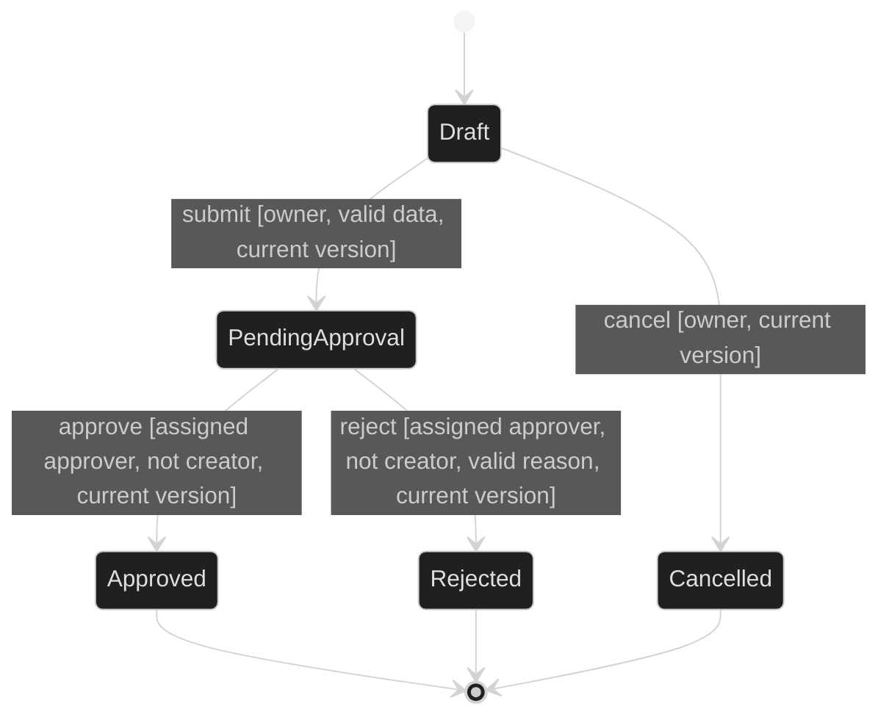
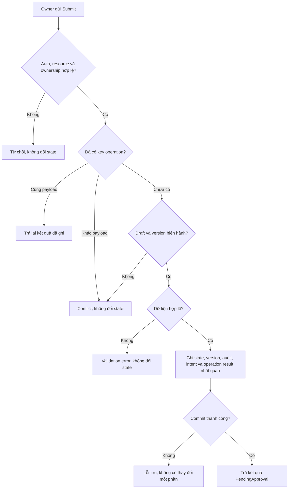

# Ví dụ đặc tả yêu cầu mở mã dự án

Mã tài liệu: **EX-PROJECT-CODE** · Gói CRM 1.3.1 · 03/11/2026

**Mục đích:** Minh họa liên kết Epic, Story, model, AC và test conditions.

**Đọc khi:** Học cách đặc tả; mọi policy/giá trị ở đây là giả định.

## Ví dụ liên kết Epic → Story → model → AC → test condition

**Tất cả tên/giá trị/rule trong ví dụ là giả định để minh họa cách đặc tả, chưa được duyệt cho CRM thật. Ví dụ chỉ khai triển các phần chính, không tự coi là bộ hồ sơ đã đủ điều kiện baseline.**

### Epic: Chuẩn bị, gửi và xét duyệt yêu cầu mở mã dự án

Epic này minh họa một phần của Feature **Quản lý Project Code**. Phạm vi gồm tạo draft, submit, approve, reject và cancel draft. Việc cấp hoặc kích hoạt mã dự án thật nằm ngoài ví dụ.

- Entity là `ProjectCodeRequest`. Actor gồm Requester và designated Approver.
- Mỗi hồ sơ có ID duy nhất và version. Retry cùng logical submit giữ nguyên số lần chuyển state, ghi audit và ghi notification intent.
- Requester thao tác draft của mình. Approver được phân công và khác người tạo mới được approve hoặc reject.

| Hành vi | Phân bổ minh họa |
|---|---|
| Tạo và lưu draft | Candidate A có giá trị riêng nếu Requester có thể mở lại và tiếp tục draft. Nếu cần giao cùng submit để tạo outcome, review lại ranh giới A và B. |
| Submit draft | Candidate B đưa hồ sơ vào PendingApproval đúng một lần. Đường đưa hồ sơ đến người xử lý và phụ thuộc vào luồng xét duyệt phải có owner trước khi đưa vào sử dụng. |
| Approve hoặc reject | Candidate C ghi quyết định của người có thẩm quyền. Xét lại sizing và các guards chung trước khi tách. |
| Cancel draft | Candidate D xử lý hủy draft còn mở. Ví dụ giữ hành vi này trong scope Epic. Story, contract và AC chi tiết vẫn cần refinement. |

### Business state và transition

Sơ đồ Mermaid minh họa trạng thái, không phải một file UML/BPMN được xác nhận tuân thủ ký pháp. Bảng dưới bổ sung hành vi cụ thể; actor/guard đã được định nghĩa trong rule và permission matrix.

| ID (kind: transition) | Source / command | Điều kiện cho phép | Target / effect | Khi không đạt |
|---|---|---|---|---|
| MOD-CRM-001 | Draft / submit | Requester là owner, dữ liệu hợp lệ, version hiện hành | PendingApproval, tăng version; ghi audit và durable notification intent | Từ chối theo nguyên nhân; không đổi dữ liệu/state |
| MOD-CRM-002 | PendingApproval / approve | Assigned Approver khác creator, version hiện hành | Approved, tăng version, audit decision | Không đổi state/data; trả lỗi phù hợp |
| MOD-CRM-003 | PendingApproval / reject | Assigned Approver khác creator, reason hợp lệ, version hiện hành | Rejected, tăng version, audit decision | Không đổi state/data; trả lỗi phù hợp |
| MOD-CRM-004 | Draft / cancel | Requester là owner, version hiện hành | Cancelled, tăng version, audit decision | Không đổi state/data; trả lỗi phù hợp |

**Disposition cho các trường hợp còn lại:** command không được liệt kê hợp lệ tại state hiện tại bị từ chối, không đổi state; gồm submit ở Approved/Rejected/Cancelled, approve/reject ở Draft và cancel khi đã PendingApproval. Replay cùng idempotency key/payload/principal/resource đã thành công là trả kết quả đã ghi, không phải một transition mới. Trường hợp reopen/resubmit từ terminal state không thuộc scope ví dụ và không được tự cho phép.

Như vậy không còn ô “state sai thì Dev tự xử lý”. Trong spec thật cần contract/error cụ thể cho mọi nhóm từ chối; bảng sau minh họa phần submit.

### Story: Owner gửi draft để chờ duyệt

**Trong phạm vi:** command submit, quyền, dữ liệu và version, retry, concurrency, response và ghi notification intent. **Ngoài phạm vi:** UI approve/reject và cơ chế gửi hoặc retry của worker. Dẫn vòng đời và guards của Epic. Nếu cần kiểm gửi thông báo thực tế, phân bổ worker và verification tương ứng cho scope có owner.

Precondition của lần submit mới: hồ sơ Draft tồn tại, actor có quyền và là owner. Postcondition: hồ sơ PendingApproval đúng một lần, version tăng một đơn vị, audit và notification intent được ghi nhất quán.

#### A. Main flow và nhánh lỗi

Replay được kiểm trước validation state/version của lần submit mới, nhưng sau authentication/authorization hiện tại: sau commit đầu tiên state đã đổi, retry được phép của cùng operation phải trả kết quả cũ; mất quyền thì không được dùng key cũ để đọc dữ liệu ngoài quyền. Việc gửi thông báo thật diễn ra nền; lỗi gửi không tự hủy quyết định submit đã commit. Dev chọn giải pháp phù hợp để bảo đảm contract này, không nhất thiết một thiết kế lưu trữ duy nhất.

#### B. Data và permission subset

| Item | Quy ước giả định | Nhóm cần kiểm |
|---|---|---|
| requestId | ID do hệ thống cấp, định danh một hồ sơ | Tồn tại/không tồn tại; request khác owner |
| expectedVersion | Số nguyên khớp version hiện hành cho operation mới | Khớp, stale, absent/invalid |
| projectName | Bắt buộc; trim đầu/cuối; 1–100 Unicode code points sau trim | Null/empty/whitespace, 1, 100, 101 code points và Unicode |
| idempotencyKey | Bắt buộc cho submit; scope theo principal + request + command | Replay payload khớp, key trùng payload khác, hai key cạnh tranh |
| permission | Requester có quyền và là owner mới submit | Sai role, đúng role nhưng sai owner, thiếu auth |

Các chính sách như thời hạn giữ operation result, giới hạn key và data retention phải được chốt trong spec thật trước baseline nếu ảnh hưởng contract/retry. Bảng mẫu không trao quyền để Dev/AI tự đặt chúng.

#### C. Decision/error rules cho submit

Các dòng được xét theo thứ tự; dòng sau chỉ áp dụng khi chưa trúng dòng trước. Response codes dưới đây là ví dụ contract, không phải quy định áp dụng sẵn cho CRM.

| ID (kind: decision rule) | Điều kiện | Kết quả giả định |
|---|---|---|
| MOD-CRM-101 | Thiếu/không hợp lệ authentication | 401, không đổi state/data |
| MOD-CRM-102 | Không có resource phù hợp | 404 theo policy disclosure được duyệt |
| MOD-CRM-103 | Actor không có quyền hoặc không là owner | 403, không đổi state/data |
| MOD-CRM-104 | Có operation cùng key nhưng payload khác | 409, không tạo operation/transition mới |
| MOD-CRM-105 | Có operation cùng key và payload khớp | Trả kết quả đã ghi; không tăng version/audit/intent lần nữa |
| MOD-CRM-106 | Operation mới nhưng state hoặc version không hợp lệ | 409, không đổi state/data |
| MOD-CRM-107 | Operation mới, state/version đúng nhưng data sai | 422, không đổi state/data |
| MOD-CRM-108 | Các điều kiện đều đạt nhưng commit thất bại | Lỗi server; không có state/audit/intent ghi một phần |
| MOD-CRM-109 | Các điều kiện đều đạt và commit thành công | Response thành công chứa state/version; ghi một logical transition |

Business/security authority phải review thứ tự lỗi và thông tin được tiết lộ; không chỉ “chọn code HTTP cho đủ”. Lỗi gửi notification sau commit thuộc xử lý nền và không rơi lại vào MOD-CRM-108.

#### D. AC và test conditions trọng yếu

| AC | Kết quả cần đạt | Test conditions dự kiến |
|---|---|---|
| AC-CRM-101 | Submit mới hợp lệ: Draft → PendingApproval, tăng version một đơn vị, audit và intent nhất quán | Đúng owner/role/version/data; kiểm response, state, version và các record/effect liên quan |
| AC-CRM-102 | Sai auth/quyền/owner bị từ chối, không có thay đổi nghiệp vụ | Thiếu auth; sai role; đúng role nhưng khác owner; đối chiếu MOD-CRM-101 và MOD-CRM-103 |
| AC-CRM-103 | Dữ liệu sai bị từ chối theo contract và giữ nguyên state/data | Với các input khác hợp lệ, kiểm 0 và 101 code points bị từ chối, 1 và 100 được chấp nhận sau trim |
| AC-CRM-104 | State sai hoặc stale version bị từ chối; không tăng version | PendingApproval với operation mới; từng terminal state; Draft với version cũ |
| AC-CRM-105 | Retry cùng operation trả kết quả cũ, không lặp logical side effects | Commit đã xong nhưng response bị mất; cùng key/payload; key cũ payload khác bị conflict |
| AC-CRM-106 | Hai operation mới cạnh tranh trên cùng version chỉ một lần chuyển thành công | Hai key trên cùng Draft/version; một thành công, một conflict; không có hai transition |
| AC-CRM-107 | Sau commit, kết quả submit và một durable intent vẫn tồn tại khi thành phần gửi chưa xử lý được thông báo | Mô phỏng thành phần gửi chưa sẵn sàng, kiểm hồ sơ vẫn PendingApproval và giữ đúng một intent. Kiểm retry/recovery của worker theo scope nhận dependency |
| AC-CRM-108 | Commit lỗi không để dữ liệu nghiệp vụ/audit/intent thay đổi một phần | Mô phỏng lỗi tại boundary ghi; kiểm toàn bộ output/record theo contract |

Đây là planned conditions, chưa phải kết quả chạy test. Khi triển khai cần bổ sung testcase/data cụ thể, tiêu chí retry/retention và cách mô phỏng/quan sát phù hợp giải pháp được duyệt.

### Vì sao ví dụ này rõ hơn một Story chỉ có mô tả?

- Dev biết transition và thứ tự replay/state validation, không tự đoán retry có phải lỗi không.
- QA biết kiểm state/data/side effects, không chỉ thông báo “Gửi thành công”.
- Business thấy quyền, ngoại lệ và kết quả khi từ chối để xác nhận có đúng mong muốn.
- PM thấy phạm vi Story submit, phần kế thừa từ Epic và câu hỏi còn phải chốt trước baseline.
- Agent có bộ nội dung và tiêu chí để hỗ trợ; không có quyền tự quyết những phần còn thiếu.

---

**Liên quan:** [Điểm vào gói](../../SKILL.md) · [Review và verdict](../requirements-review-process-and-verdicts.md) · [Nguồn và cách điều chỉnh](../standards-and-crm-tailoring.md).
